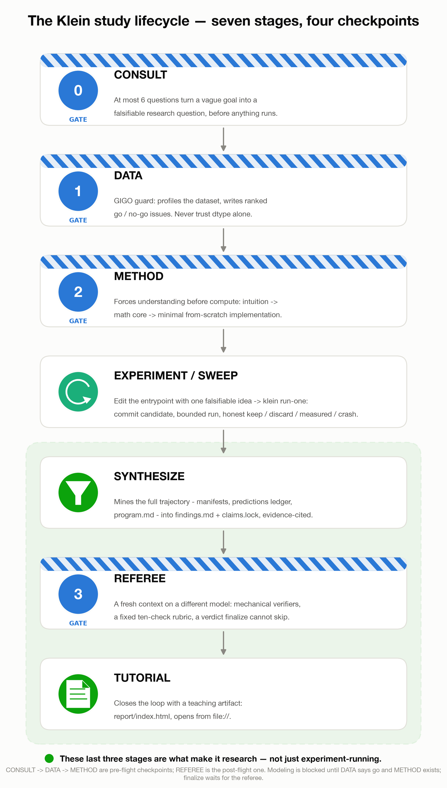

# Klein Auto Research

[](https://github.com/Xiang-Shan/klein-auto-research/actions/workflows/ci.yml)
[](https://github.com/Xiang-Shan/klein-auto-research/releases)
[](https://github.com/Xiang-Shan/klein-auto-research/blob/main/LICENSE)
[](https://github.com/Xiang-Shan/klein-auto-research/blob/main/pyproject.toml)

**A research framework for AI for Science that you can trust the next morning.**

An AI agent can run experiments all night. Klein is what lets you believe the result:
it makes the agent (or you) write down each prediction *before* the evidence, records
every run so it cannot be quietly redone, ties every number in the write-up to the file
it came from, and has someone who did not do the work review it. Anyone can then re-check
the whole study with one command and no AI involved.

It works on your data, on public data, on a simulator, or on a maths problem with nothing
but a checker.

## What you get from one study

A study is one research question, worked start to finish in one folder. It leaves:

| File | What it is |
|---|---|
| `study.yaml` | The **contract**: the question, the metric, and each prediction with the rule that will decide it — fixed before any result exists |
| `runs/E0001/…` | Every **run**, kept or not, with the exact code it executed. Failed ideas are evidence too |
| `findings.md` + `claims.lock` | What was learned, as numbered **claims**; every number is tied to the file and hash it came from |
| `referee_report.md` | The verdict of an independent **referee** — a different model, tool or person |
| `report/index.html` | A self-contained **teaching report**: the question, the method explained, the journey, the findings |

Open one now: [`studies/10-hubble-1929-replication/report/index.html`](https://github.com/Xiang-Shan/klein-auto-research/blob/main/studies/10-hubble-1929-replication/report/index.html)
(does Hubble's 1929 constant reproduce from his own tables?).

## Quickstart — 5 minutes

You need Python ≥ 3.11, [uv](https://docs.astral.sh/uv/) and git. Nothing is downloaded
beyond the Python packages, and no account or API key is needed.

```bash
git clone https://github.com/Xiang-Shan/klein-auto-research
cd klein-auto-research
uv sync --locked --extra encoders
uv run klein demo
```

`klein demo` builds a tiny study in `./klein-demo` and runs it live, explaining each step:
a first look at the data, three checkpoints, a measured noise level, then three
experiments — two kept, one discarded, and a prediction refuted by arithmetic — and a
map of what was learned. It takes about 15 seconds, works offline, and touches nothing
else: the demo study is its own git repository.

Then look at a finished study and check it yourself:

```bash
uv run klein map --study studies/10-hubble-1929-replication       # the study as a map
uv run klein verify --study studies/10-hubble-1929-replication --no-receipt   # re-check everything
uv run klein explain gate                                         # any term, in plain words
```

## How a study works

Every study moves through seven stages, past four gates:

```
new ─▶ CONSULT ─▶ DATA ─▶ METHOD ═══▶ EXPERIMENT/SWEEP ─▶ SYNTHESIZE ─▶ REFEREE ─▶ TUTORIAL
        Gate 0   Gate 1   Gate 2      └ the honest loop ┘    findings.md    Gate 3     report/
```

<p align="center"></p>

A **gate** is a checkpoint a person acknowledges. Nothing is run before the first three.

| Gate | The question it asks | What it produces |
|---|---|---|
| 0 — Consult | Is the question well posed, and what would count as an answer? | the contract and the registered predictions |
| 1 — Data | Is this data fit to answer it? Any leakage? | a data card with a go / no-go decision |
| 2 — Method | Is the method understood — intuition, maths, a minimal implementation? | a method card with verified references |
| 3 — Referee | Do the findings follow from the record? | an independent verdict |

Between Gate 2 and Gate 3 is the loop. One idea, one run, one honest outcome:

- **You (or your agent) decide what to try.** Klein never proposes or retries anything.
- **`klein run-one` witnesses it.** It saves the code, runs it once, and decides the
  outcome by the contract's arithmetic: `keep`, `discard`, `measured`, or `crash`.
- **A difference only counts if it beats the noise.** The noise level is measured first,
  not guessed; a gain smaller than it is recorded as a discard.
- **The untouched data is read once.** A sealed part of the data confirms the result at
  the end, after a mandatory rehearsal.

Three habits make a study something you understand, not just a number:

| Habit | Command | Why |
|---|---|---|
| Look on the record | `klein probe -- python look.py` | Exploring is cheap and logged; a look can suggest a prediction but never prove a claim |
| Read the study as a map | `klein map --study <dir> --html` | Question → predictions → runs → claims → decisions, and what is still open |
| Ask what a word means | `klein explain <term or stage>` | Every term and every procedure, from any directory |

## Run your own study

**With an AI agent (the usual way).** Open this repository in your agent and ask, for
example: *"Run a Klein study: does gradient boosting beat a GLM on my claims table at
`data/claims.csv`?"* The agent follows the written procedures and stops at each gate for
your decision.

| You use | How |
|---|---|
| Claude Code, in this repo | the `/klein` skill and eight worker agents are already wired |
| Claude Code, in your own project | `/plugin install klein --marketplace Xiang-Shan/klein-auto-research` |
| Codex, Copilot, Cursor, Gemini CLI, … | they read [`AGENTS.md`](https://github.com/Xiang-Shan/klein-auto-research/blob/main/AGENTS.md), the operating manual |
| Claude Science | the kit in [`integrations/claude-science/`](https://github.com/Xiang-Shan/klein-auto-research/blob/main/integrations/claude-science/README.md) |
| Your own product | `kleinlib.api`, `klein <verb> --json`, or the read-only `klein mcp` server — [`docs/embedding.md`](https://github.com/Xiang-Shan/klein-auto-research/blob/main/docs/embedding.md) |

Klein itself never calls a model and needs no API key. Your agent brings its own.

**By hand.** Every step is a plain command, and `klein next` always names the one to run:

```bash
klein new 30-my-question --recipe tabular-predict     # scaffold a typed study with runnable code
git switch -c experiments/30-my-question
klein next --study studies/30-my-question             # repeat: it tells you the next action and why
```

The full walk-through, from an empty folder to a signed report, is
[`docs/quickstart.md`](https://github.com/Xiang-Shan/klein-auto-research/blob/main/docs/quickstart.md).
Recipes exist for tabular prediction, image classification, deep-learning scaling laws,
LLM evaluation, causal analysis and verifier-checked maths (`klein new --help`).

**Elsewhere.** `pip install klein-auto-research` gives you the same `klein` command with
every procedure built in; `klein skill install` copies them into your repository.

## Ten words to know

| Word | Meaning |
|---|---|
| **study** | one question, worked start to finish in one folder |
| **contract** | `study.yaml`: what the study commits to before any result exists |
| **prediction** | a belief written down first, with the arithmetic rule that will decide it |
| **gate** | a checkpoint a person acknowledges before the study continues |
| **run** | one execution of the study's code, recorded whether it worked or not |
| **noise floor** | how much the metric moves when nothing real changed; sets the smallest gain that counts |
| **sealed data** | the part of the data nobody looks at until the single confirming run |
| **probe** | a quick look, on the record, that can never be used as evidence |
| **claim** | one numbered sentence the study asserts, with its supporting runs and its strength |
| **referee** | a reviewer who did not run the study |

The full glossary: [`glossary.md`](https://github.com/Xiang-Shan/klein-auto-research/blob/main/.claude/skills/klein/references/glossary.md), or `klein explain <word>`.

## The exhibits

Eight finished studies ship with Klein, one per domain and kind of question. Each ran
the whole lifecycle in this repository's history and is re-verified on every push.

| Study | Question type · evidence · audience | What it showed |
|---|---|---|
| [`00-known-truth-quickstart`](https://github.com/Xiang-Shan/klein-auto-research/tree/main/studies/00-known-truth-quickstart/) | predict · table · general | With the best possible score known in advance, a short ladder of models closed most of the distance to it |
| [`10-hubble-1929-replication`](https://github.com/Xiang-Shan/klein-auto-research/tree/main/studies/10-hubble-1929-replication/) | replicate · table · general | Hubble's published 465 cannot be reproduced from his tables — for missing inputs, not method |
| [`11-exact-verifier-construction`](https://github.com/Xiang-Shan/klein-auto-research/tree/main/studies/11-exact-verifier-construction/) | optimize · checker only · mathematics | No improvement under an exact checker — and what a search may honestly claim then |
| [`12-insurance-claims-frequency`](https://github.com/Xiang-Shan/klein-auto-research/tree/main/studies/12-insurance-claims-frequency/) | predict · table · insurance | A three-model ladder reproduced on 58,592 real policies under a measured noise floor |
| [`20-llm-cot-contamination`](https://github.com/Xiang-Shan/klein-auto-research/tree/main/studies/20-llm-cot-contamination/) | test · text · LLM evaluation | Chain-of-thought gave no measurable gain on GSM8K or on freshly generated twins of its problems |
| [`21-bloodmnist-cnn`](https://github.com/Xiang-Shan/klein-auto-research/tree/main/studies/21-bloodmnist-cnn/) | predict · images · computer vision | From pixel regression to a small CNN on blood-cell images: which single changes clear the noise |
| [`22-cnn-data-scaling`](https://github.com/Xiang-Shan/klein-auto-research/tree/main/studies/22-cnn-data-scaling/) | estimate · images · ML research | A fitted data-scaling law over-predicted the sealed full-data loss by 28 % |
| [`23-lalonde-causal-replication`](https://github.com/Xiang-Shan/klein-auto-research/tree/main/studies/23-lalonde-causal-replication/) | replicate · table · data science | The classic job-training benchmark: what a naive comparison misses, and what propensity methods recover |

Nine earlier studies are archived, not deleted: [`studies/ARCHIVE.md`](https://github.com/Xiang-Shan/klein-auto-research/blob/main/studies/ARCHIVE.md)
says where each one still verifies.

## What is in this repository

| Path | What it holds |
|---|---|
| `kleinlib/` | the engine and the `klein` command; `kleinlib/api.py` is the stable Python surface |
| `.claude/skills/klein/` | the written procedures (plain markdown), card templates, audience profiles |
| `.claude/agents/` | eight worker agents, one per stage |
| `studies/` | the exhibits — and where your own studies go |
| `knowledge/` | lessons promoted from finished studies, each cited to the claim that earned it |
| `docs/` | [`quickstart.md`](https://github.com/Xiang-Shan/klein-auto-research/blob/main/docs/quickstart.md), [`cli.md`](https://github.com/Xiang-Shan/klein-auto-research/blob/main/docs/cli.md) (every command), [`embedding.md`](https://github.com/Xiang-Shan/klein-auto-research/blob/main/docs/embedding.md), [`design/`](https://github.com/Xiang-Shan/klein-auto-research/blob/main/docs/design/klein-3-design.md) (why it is built this way) |
| `datasets/`, `integrations/`, `scripts/` | bundled data with licences, host kits, the end-to-end proofs CI runs |

## What Klein does not do

- It cannot make a model reason better. It makes reasoning failures visible: a refuted
  prediction with no recorded decision, a discarded run the write-up ignored, a number
  with no source.
- It runs one experiment at a time. It does not schedule, parallelize or search for you.
- A referee is independent by arrangement, not by magic: a fresh session of the same
  model is the weakest form, and the form used is written on the record.
- A measured noise floor says what is detectable, not what is true; a claims lock checks
  that numbers have sources, not that they were the right numbers to look at.
- A study that calls a hosted model can be re-verified from what the model answered, but
  nobody can make that model answer the same way next year.

## Why it is built this way, and credits

A 2026 study of more than 25,000 runs of AI-scientist systems
([arXiv:2604.18805](https://arxiv.org/abs/2604.18805)) found that agents produce results
without reasoning scientifically, and that judging outcomes alone cannot detect it. Klein
checks the *process* instead, mechanically. The argument, the design decisions and the
roadmap are in [`docs/design/klein-3-design.md`](https://github.com/Xiang-Shan/klein-auto-research/blob/main/docs/design/klein-3-design.md);
the failures that paid for each rule are in
[`war-stories.md`](https://github.com/Xiang-Shan/klein-auto-research/blob/main/.claude/skills/klein/references/war-stories.md).

Klein descends from [karpathy/autoresearch](https://github.com/karpathy/autoresearch)
(the lab notebook and the edit-run-log loop) via
[elan-elan/agent-smith](https://github.com/elan-elan/agent-smith). The name nods to the
Klein bottle: a research loop whose output feeds its own input — a study's findings
become the next study's starting knowledge.

Release notes: [`CHANGELOG.md`](https://github.com/Xiang-Shan/klein-auto-research/blob/main/CHANGELOG.md).
To cite: [`CITATION.cff`](https://github.com/Xiang-Shan/klein-auto-research/blob/main/CITATION.cff).
To contribute: [`CONTRIBUTING.md`](https://github.com/Xiang-Shan/klein-auto-research/blob/main/CONTRIBUTING.md).
Security: [`SECURITY.md`](https://github.com/Xiang-Shan/klein-auto-research/blob/main/SECURITY.md).
MIT licensed ([LICENSE](https://github.com/Xiang-Shan/klein-auto-research/blob/main/LICENSE));
data and lineage notices in [`THIRD_PARTY_NOTICES.md`](https://github.com/Xiang-Shan/klein-auto-research/blob/main/THIRD_PARTY_NOTICES.md).
