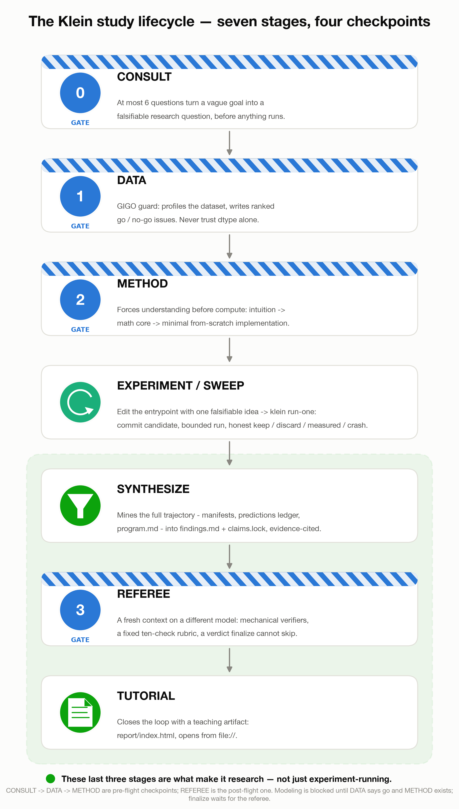
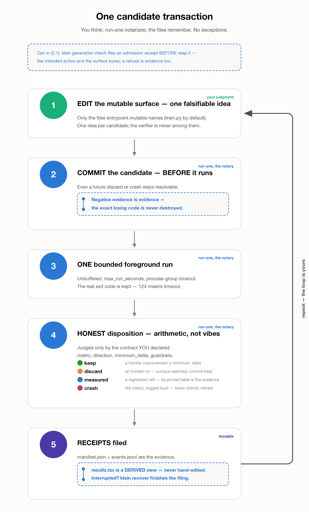
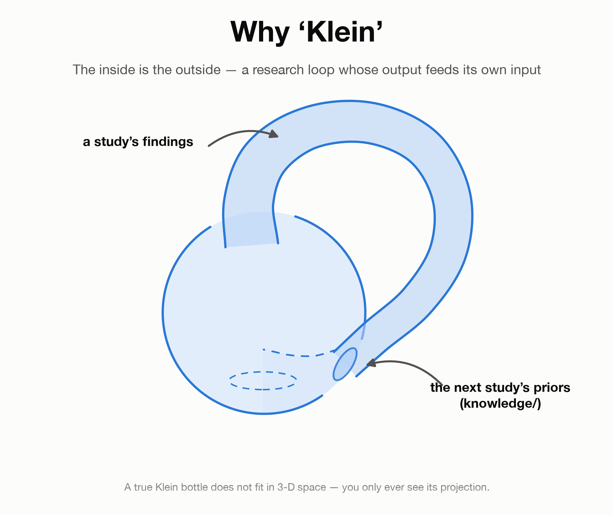

# Klein Auto Research

[](https://github.com/Xiang-Shan/klein-auto-research/actions/workflows/ci.yml)
[](https://github.com/Xiang-Shan/klein-auto-research/releases)
[](LICENSE)
[](pyproject.toml)

**Process-verifiable research for AI for Science.** Klein is the lab-notebook
discipline an AI agent runs *inside*: predictions registered before their evidence,
every run notarized in git, claims whose strength is earned, an independent referee
before anything is called a finding. It works on your data, on public data, on a
simulator, or on nothing but a verifier — and a stranger can audit the whole process
with no model in the loop.

It is not hard to let an agent do research overnight. What is hard is signing the
conclusion the next morning. Klein exists for the signature.

Every study moves through seven stages, past four gates:

```
new ─▶ CONSULT ─▶ DATA ─▶ METHOD ═══▶ EXPERIMENT/SWEEP ─▶ SYNTHESIZE ─▶ REFEREE ─▶ TUTORIAL
        Gate 0   Gate 1   Gate 2      └ the honest loop ┘    findings.md    Gate 3     report/
```

<p align="center"></p>

## Quickstart (5 minutes)

Needs Python ≥ 3.11, [uv](https://docs.astral.sh/uv/), and git. No credentials and no
downloads: every dataset an exhibit needs is bundled or generated.

```bash
git clone https://github.com/Xiang-Shan/klein-auto-research
cd klein-auto-research
uv sync --locked --extra encoders
uv run --no-sync klein doctor                       # what this machine can run; fetches nothing
uv run --no-sync klein verify --study studies/00-known-truth-quickstart --numbers   # the receipt
```

Then open `studies/00-known-truth-quickstart/report/index.html` — offline, one file —
and read its `claims.lock`: every number on that page has a home there.

Two longer checks are optional: `uv run --no-sync pytest kleinlib/tests
.claude/skills/klein/scripts/tests scripts/tests -q` for the suite, and
`uv run --no-sync python scripts/verify_shipped_studies.py` to re-verify every shipped
ledger — the same proof CI runs on every push.

Extras compose, and `uv sync` *removes* the ones you omit. `--extra gbdt` for
LightGBM/XGBoost/CatBoost, `--extra deep` for PyTorch (only to re-run the
character-language-model exhibit).

To take one study of your own from scaffold to signed tutorial, follow the
walk-through in [`docs/quickstart.md`](docs/quickstart.md).

## Why Klein

In April 2026, a study of 25,000+ runs of AI-scientist systems across eight domains
(Ríos-García, Jablonka et al., [arXiv:2604.18805](https://arxiv.org/abs/2604.18805))
found that agents produce results without reasoning scientifically — and that
outcome-based evaluation cannot detect it. Scaffolding explained 1.5 % of outcome
variance. No scaffold makes a model reason better; what a scaffold *can* do is make
the failures detectable. Klein does that mechanically, with no model checking itself:

| Failure the 2026 study measured | What Klein makes mechanical |
|---|---|
| **Evidence ignored** — 68 % of traces | Every candidate is committed *before* it runs; `klein verify --evidence-use` reports what the write-up ignored |
| **No belief revision on refutation** — 26 % revise | Predictions carry an arithmetic rule; a refuted one with no dated `Decision:` line fails verification |
| **Convergent evidence rare** | One sealed look per track; `confirmed` needs the evidence kinds the track requires, and single-source confirmations are flagged |
| **Outcome evaluation cannot see it** | An independent referee, on a different model, applies a fixed ten-check rubric before `finalize` |

The rest of the discipline is the part its studies paid for: a measured noise floor
before any comparison, a detection-limit law, contract-driven splits, a sealed dry-run,
errata that re-scope and never delete. The incident reports are in
[`war-stories.md`](.claude/skills/klein/references/war-stories.md); the promoted
lessons, each cited to the claim that earned it, in
[`knowledge/research-discipline.md`](knowledge/research-discipline.md).

## One kernel, any inquiry

A study is typed on three orthogonal axes; the same trust kernel serves all of them.

| Axis | Values | What it changes |
|---|---|---|
| **kind** — the question's shape | `predict` · `estimate` · `test` · `simulate` · `replicate` · `discover` · `optimize` | track mode, what "sealed" means, what `confirmed` requires |
| **modality** — the evidence source | `tabular` · `timeseries` · `image` · `sequence` · `graph` · `text` · `simulation` · `none` | which data-gate card the DATA gate demands |
| **profile** — the audience | `generic` · `ml-research` · `math` · `insurance` · `llm` · `cv` · `data-science` · your own `profile_doc` | headings, doctrine, figures, budgets, banned words |

A mathematician's keep means "beat the best known value"; a deep-learning researcher's
means "clear a five-seed noise floor". The engine does not know the difference; the
protocols do — [`inquiry-model.md`](.claude/skills/klein/references/inquiry-model.md).

## Pick your domain

Klein 2.3 ships a recipe per domain: `klein new NN-slug --recipe <id>` pre-fills the three
axes, the metric and split, the 2.3 contract blocks, and a `prepare.py` + entrypoint that
smoke offline — leaving every judgment (predictions, priors, the data card's findings)
for you, so no gate can be rubber-stamped.

| Domain | Recipe | Typed as | What the pack brings | Exhibit |
|---|---|---|---|---|
| tabular ML | `tabular-predict` | predict · tabular · generic | binary/regression evaluators, the clean-room leakage audit | 00, 15 |
| computer vision | `cv-classify` | predict · image · cv | index splits (official or grouped), image near-duplicate audit, `evaluate_multiclass`, seed arrays | 21 |
| deep-learning training | `dl-scaling` | estimate · image · ml-research | seed arrays, step budgets, usage + hardware records, detached runs | 22 |
| LLM evaluation | `llm-eval` | test · text · llm | the model-call ledger (offline replay), `evaluate_items`, contamination audit, fresh sealed items | 20 |
| data science / causal | `ds-causal` | estimate · tabular · data-science | multi-file `data.inputs`, bootstrap intervals, an estimate-vs-benchmark design | 23 |
| mathematics | `math-verify` | optimize · none · math | a declared verifier that decides every run, exact metrics | 11, 24 |

Every recipe accepts the explicit flags below (they win), and `--runner python` for hosts
without uv. `klein next --study <dir>` then names the one next action at every step.

## Run it on your own question

New studies default to `schema_version: 3` and are driven through the packaged `klein`
command. Six moves, in order:

1. **Scaffold, typed** — `klein new … --kind … --modality … --profile … --data <source>`
   (`csv:`, `parquet:`, `synthetic:`, `bundled:`, `hub:`, `sklearn:`, `openml:`, `url:`;
   network sources are pinned by sha256 and refused under `KLEIN_OFFLINE=1`).
2. **CONSULT** — at most six questions turn the goal into predictions with rules.
3. **DATA** — the modality-typed card ranks go/no-go issues; partitions come from the
   contract, never from a seed in a script.
4. **METHOD** — the card teaches the method to your audience; a verifier, when declared,
   is hashed here and never edited again.
5. **EXPERIMENT** — branch, pass `klein preflight`, run one candidate at a time, and
   rehearse the sealed run before you spend it.
6. **CLOSE** — SYNTHESIZE writes findings and the lock; the REFEREE reads them before
   the story; the tutorial teaches it back.

```bash
klein new 14-my-question --kind predict --modality tabular --profile generic \
    --metric val_auc --goal-direction higher --data "csv:data/my.csv" --track primary
git switch -c experiments/14-my-question       # the loop refuses to run on main
klein gate record consult --study studies/14-my-question --acknowledged-by <name>   # then data, method
klein noise-floor --study … --recipe seed-sweep --estimand fit-noise   # measure the keep bar
klein preflight   --study …                                            # then the loop:
klein run-one     --study … --track primary --description "anchor" --tests P1
klein run-one     --study … --track primary --final-test --dry-run     # rehearse the seal
klein claims init --study … && klein gate record referee --study …
klein finalize    --study … && klein verify --study …    # writes verify_receipt.json
```

Run `--help` on any command for its full arguments. The CLI commits its own receipts,
so the loop never dead-ends on state it generated itself; `gate override`,
`headroom ack` and `stop ack` each put a reason on the record instead of silently
bypassing a rule. Compute is one bounded foreground subprocess per run on whatever you
have — or, in a study that opts in, one detached job on a GPU host whose receipt the
notary checks (`run-one --detach` → `klein job exec` → `run-one --collect`); long runs
are budgeted in steps or tokens, not seconds. The full contract is in
[`AGENTS.md`](AGENTS.md), the step-by-step walk-through in
[`docs/quickstart.md`](docs/quickstart.md), the device rules in
[`compute-and-devices.md`](.claude/skills/klein/references/compute-and-devices.md).

<p align="center"></p>

### Detection limit: audit headroom before spending challengers

A measured noise floor can honestly outgrow the incumbent's entire distance to
perfection — then no challenger can ever win, and nothing says so. Declare the metric's
best achievable value and Klein does the subtraction:
`h = (incumbent − ideal) / minimum_delta`, disclosed at preflight, verify and run-one.
`h < 1` refuses further development runs until `klein headroom ack` records the closed
door. Read `h ≥ 1` as "not excluded", never as "plausible": study 08 stood at
h = 1.015 and twenty-one challengers produced zero keeps.

## The generation layer (opt-in, since 2.1)

A schema-3 study may also record what it committed to *before* the evidence existed:

```bash
klein generation init   --study … [--capability NAME]…      # before the CONSULT gate
klein generation check  --study … --action run --track …    # before every run-one
klein generation verify --study …    # generation/verify_receipt.json, its own audit
klein generation label  --study …    # generation-verified: both receipts, one HEAD
```

`check` binds the intended action to the exact bytes of `entrypoint.mutable`; the audit
classifies every run `admitted | unadmitted | refused-but-run | mismatched | replayed`;
a refusal is committed like an admission, so ignoring one is detectable; and order comes
from three local witnesses — extension chain, core anchor, git ancestry — never a clock.
Ten capabilities are declared at `init`: `expertise` (reproduce the domain baseline) ·
`slates` (score your own forecasts) · `premortem` (a recorded red team) · `design` (what
the evidence is for) · `parity` (a preregistered expert comparison) · `contribution`
(the AI-value ledger: who proposed, who accepted) · `surprise` (registered discovery
cells with complete tables) · `escalation`
(an accounted ladder out of a stall) · `knowledge` (cross-study claims over pinned
evidence) · `benchmark` (planted truths under a hash commitment).

The layer never proposes, ranks, selects, schedules or retries. A study that does not
opt in is untouched: no core verb, receipt or disposition changes either way. Protocol:
[`generation-protocol.md`](.claude/skills/klein/references/generation-protocol.md).

## Drive it with your agent — or none

Klein is agent-agnostic: no Klein verb calls a model API (a study's entrypoint may,
through the call ledger, which pins every request and response so the study re-verifies
offline). The operating manual is [`AGENTS.md`](AGENTS.md); every protocol it points to
is plain markdown.

| You use… | How to drive Klein |
|---|---|
| **Codex, Copilot, Cursor, Jules, …** | They auto-read `AGENTS.md` — just ask for a Klein study |
| **Claude Code** | The `/klein` skill routes the stages; eight worker agents ship pre-wired |
| **Claude Science** | The kit in [`integrations/claude-science/`](integrations/claude-science/README.md): import the skill from GitHub, a `klein-researcher` Specialist, Reviewer criteria as a pre-referee pass, `klein mcp` as a Local command connector, GPU cells as detached runs on SSH/Slurm or Modal job cards; REFEREE goes to a different session or tool |
| **Any MCP client** | `klein mcp --root <repo>` — read-only tools (`next`, `status`, `verify`, …); no gate or run tool by design |
| **Gemini CLI / Qwen Code** | Add `AGENTS.md` to the context files |
| **GLM & Anthropic-compatible CLIs** | They load `CLAUDE.md`, which imports `AGENTS.md` |
| **No agent** | `AGENTS.md` doubles as a human runbook; every helper is a plain CLI |

Where Klein sits among its neighbours — positioning, not a benchmark:

| | Claude Science | [Kosmos](https://arxiv.org/abs/2511.02824) | [Curie](https://arxiv.org/abs/2502.16069) | autoresearch | **Klein** |
|---|---|---|---|---|---|
| Runs where | hosted workbench | hosted | local | local | local, from git |
| Model | Claude | its own | any | any | any — none inside Klein |
| Unit of work | a session | a world model | an experiment | one script | a typed inquiry |
| Verification | reviewer agent | citation trails | rigor modules | keep / discard | ledger arithmetic, then a referee |
| Pre-registration | plan first | — | — | — | hashed arithmetic rules |
| Audit by a stranger | message history | citations | — | git history | every claim resolves |

Klein does not compete with a workbench on connectors or scale; it is the discipline a
workbench's agent can run *inside* — 2.3 makes that concrete with the Claude Science kit.
The full argument: [`docs/design/klein-2-design.md`](docs/design/klein-2-design.md) and
[`docs/design/klein-2.3-design.md`](docs/design/klein-2.3-design.md) (kernel, domain
packs, host bridges).

## The shipped studies

Every study below ran the whole lifecycle in this repository's history: every candidate
commit resolves and every ledger verifies, checked by CI on every push.

**Schema-3 exhibits — studies across the axes of generality:**

| Study | Typed as | What it showed |
|---|---|---|
| [`00-known-truth-quickstart`](studies/00-known-truth-quickstart/) | predict · tabular · generic | With the Bayes-optimal score known, three keeps closed most of the distance to it, and the one sealed look confirmed the level |
| [`10-hubble-1929-replication`](studies/10-hubble-1929-replication/) | replicate · tabular · generic | Hubble's 465 is unreproducible for missing inputs, not method; his own 24 objects support a value whose interval contains it |
| [`11-exact-verifier-construction`](studies/11-exact-verifier-construction/) | optimize · none · math | Zero keeps by arithmetic under an exact verifier — and what a search may claim when it cannot win |
| [`12-insurance-claims-frequency`](studies/12-insurance-claims-frequency/) | predict · tabular · insurance | All three v1 anchors reproduce on 58k real claims; the measured floor leaves the v1 ladder exactly one keep |
| [`13-charlm-fixed-budget`](studies/13-charlm-fixed-budget/) | predict · text · ml-research | At a fixed step budget, none of four registered levers cleared the noise floor; the only gain carried no prediction |
| [`15-iris-90years-relaunch`](studies/15-iris-90years-relaunch/) | predict · tabular · generic | The metric pegged at its ideal, so the measured floor was exactly zero, the headroom law was disarmed and four ties were read as four keeps — the instrument failed, and that failure is the finding |
| [`20-llm-cot-contamination`](studies/20-llm-cot-contamination/) | test · text · llm | Chain-of-thought gave no measurable gain on GSM8K or on freshly generated twins: both arms already scored between 0.95 and 0.985 exact match, and the "direct" arm wrote its working anyway; every model call is ledgered, so the study re-verifies with the network off |
| [`21-bloodmnist-cnn`](studies/21-bloodmnist-cnn/) | predict · image · cv | Under a 3-seed floor only batch norm (with running statistics recomputed on the training set) cleared the bar alone; a four-lever bundle reached 0.9465 sealed macro-F1 and an accuracy indistinguishable from ResNet-18 (28) — with no lever attributable |
| [`22-cnn-data-scaling`](studies/22-cnn-data-scaling/) | estimate · image · ml-research | The fitted data-scaling law over-predicted the sealed full-data loss by 28 %, the opposite sign to the registered prediction; the size cells ran as attested detached jobs |
| [`23-lalonde-causal-replication`](studies/23-lalonde-causal-replication/) | replicate · tabular · data-science | The naive difference in means against PSID controls misses the NSW benchmark by more than the benchmark itself; of IPW, matching and AIPW only AIPW landed within $1,000, and it held on the sealed CPS lane |
| [`24-golomb-llm-vs-search`](studies/24-golomb-llm-vs-search/) | test · none · math | At a matched budget of verifier calls an LLM matched known optimal Golomb rulers on 6 of 12 development pairs against 0 for a classical randomized search — every match a tabulated row — and neither arm matched any optimum at the sealed orders 12–13 |

**Schema-2 exhibits (frozen; they verify under schema-2 rules forever):**

| Study | What it showed |
|---|---|
| [`03-noisy-rosenbrock-dfo`](studies/03-noisy-rosenbrock-dfo/) | Restarts beat Nelder-Mead at 2.96× the measured floor and replicate sealed — but random search ties them |
| [`05-fremtpl2-gap-forensics`](studies/05-fremtpl2-gap-forensics/) | On 678k rows the GBDT's sealed edge is 9.3× its paired SE, and ≈83 % of it is non-additive |
| [`06-hurricane-gqls-returnlevels`](studies/06-hurricane-gqls-returnlevels/) | All 120 published parameters reproduced sealed, once the loop found the thesis's own quantile convention |
| [`07-iris-90years`](studies/07-iris-90years/) | The measured floor outgrew the anchor's whole distance to perfection — the study that produced the headroom law |
| [`08-iris-rematch`](studies/08-iris-rematch/) | Twenty-one challengers walked through a door ajar at h = 1.015 and produced zero keeps |
| [`09-iris-first-lesson`](studies/09-iris-first-lesson/) | Door closed at h = 0.33 before a challenger ran; an erratum re-scoped a retired seed rather than deleting it |

Earlier exhibits and the original v1 quickstart are preserved intact at tags
[`v1.0.0`](https://github.com/Xiang-Shan/klein-auto-research/tree/v1.0.0/studies) and
[`v1.3.0`](https://github.com/Xiang-Shan/klein-auto-research/tree/v1.3.0/studies).
To see what "closing the loop" means, open any tutorial:
`open studies/10-hubble-1929-replication/report/index.html`.

## Limitations

Klein cannot make a model reason better — it makes reasoning failures detectable. It
runs one experiment at a time and does not schedule, parallelize, or learn a policy
across runs. It does not execute notebooks (`klein notebook` writes a reading copy, never
evidence). The referee is independent by mechanism, not by magic: a fresh session of the
same model is the lowest rung of the independence ladder, and the rung reached is on the
record; Claude Science's built-in Reviewer runs on the session's own model and never
stands in for Gate 3. A measured floor bounds honesty, not power; a lock verifies that
numbers have homes, not that the homes were the right places to look. A detached run is
attested, not observed — its receipt is checked, its process was not watched. The call
ledger makes a model-calling study re-verify offline from what the model answered; it
cannot make a hosted model answer the same way next year, which is why a re-query is a
replication and a replay is not. Evaluators cover binary and multiclass classification,
point and rate regression (incl. Poisson/Gamma/Tweedie deviance), per-item benchmarks
(exact match, pass@k), ranking, survival, segmentation, scalar, estimate, test and table
cells; detection mAP is not shipped. The Claude Science kit is documented against that
product's published docs; a live smoke needs a person with a Claude Science seat and is
filed under `docs/reviews/` only when one has run.

## Harness or skill? Both — a harness that carries a skill.

- **Harness (recommended):** clone this repo and run studies inside it — engine,
  protocols, agents, knowledge base and executed exhibits, with commit hashes that
  resolve.
- **Skill (portable doctrine):** copy `.claude/skills/klein/` into any repo. The
  protocols are self-contained markdown and the engine is a one-line git dependency
  pinned by tag *and* commit (see `assets/pyproject-study-template.toml`).

## Layout

| Path | What |
|---|---|
| `AGENTS.md` | the operating manual — any agent, or a human |
| `.claude/skills/klein/` | lifecycle protocols, profiles, templates, helper scripts |
| `.claude/agents/` | eight optional worker-role definitions |
| `kleinlib/` | the engine: contract, events, state, transactions, checks, claims, `generation/` |
| `knowledge/` | promoted lessons and domain knowledge by profile |
| `datasets/` | bundled datasets with their licences and provenance |
| `studies/` | one directory per study — the unit of research |
| `docs/` | `quickstart.md`, the Klein 2.0 design rationale, `migration-schema2-to-3.md`, driver reviews |
| `scripts/` | the end-to-end proofs, including tests of the docs themselves |

## Lineage & citing

Klein descends from [karpathy/autoresearch](https://github.com/karpathy/autoresearch)
(the `program.md` lab notebook and edit-run-log loop) via
[elan-elan/agent-smith](https://github.com/elan-elan/agent-smith) (the loop as a
portable skill). Klein keeps the loop and adds the gates, the notary, the registered
predictions, the claims lock, the referee, and the mandatory synthesis and tutorial
stages. The name nods to the Klein bottle: a research loop whose output feeds its own
input.

<p align="center"></p>

Release history is in [`CHANGELOG.md`](CHANGELOG.md); versioning is SemVer, and 2.0.0
froze the schema-3 contract, the CLI surface and the ledger formats; 2.1.0 adds the
opt-in generation layer beside them without changing any of the three; 2.2.0 makes the
report read the study's records. To cite Klein see
[`CITATION.cff`](CITATION.cff); to contribute, [`CONTRIBUTING.md`](CONTRIBUTING.md);
for vulnerabilities, [`SECURITY.md`](SECURITY.md). The software is MIT licensed
([LICENSE](LICENSE)); third-party data and lineage notices are collected in
[`THIRD_PARTY_NOTICES.md`](THIRD_PARTY_NOTICES.md).
